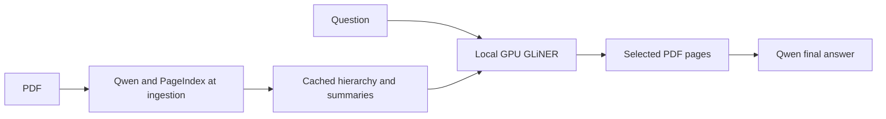

# GLiNER hierarchy demo

The default demo uses `fastino/GLiNER2.5-Decide` on the RTX 5070 Ti with BF16
inference and batches of eight for binary page chunks. Qwen generates the final
answer from up to three selected pages. No generative LLM chooses sections or
pages. There are no TypeSafe API calls or TypeSafe credentials in this route.

## Ingestion versus query

Qwen builds the PageIndex hierarchy and node summaries at ingestion. This output
is saved per document and reused across queries. GLiNER consumes that saved
model output; it does not build or summarize the index at query time.



The demo's classic model-built indexes are separate from the earlier Flash
indexes. Build only these three reports, not the entire bucket:

```bash
uv run --no-project --no-env-file --python bench/.venv-gpu/bin/python bench/pageindex_build.py --mode classic --workers 2 --documents 3M_2018_10K 3M_2022_10K 3M_2023Q2_10Q
uv run --no-project --no-env-file --python bench/.venv-gpu/bin/python bench/pageindex_demo.py --tree-dir bench/data/pageindex_classic --run --answer --label classic_model_index
```

Reported query costs separate the one answer call from the two offline judge
calls. GPU retrieval uses no generative API tokens. Indexing cost and local GPU
compute cost are separate and are not assumed to be zero.

The adapter executes the checksum-pinned reference beam traversal, page search,
and verification functions. PageIndex nodes carry query-independent summaries.
GLiNER receives the question, document identity, ancestor titles and summaries,
and candidate descriptions. Native classification uses readable label names,
mapped back to PageIndex node IDs after inference. Opening pages inherit parent
context. Long page menus use full-coverage binary chunks rather than silent
truncation; their normalized odds are a heuristic, not calibrated probabilities.

The 512-position limit in the earlier adapter was a conservative assumption.
A recorded GPU probe passed a 2,472-position input through the encoder intact
and used about 3,355 MiB peak allocated memory. The adapter now permits native
categorical menus up to 4,096 positions; longer menus still use bounded chunks.
This proves execution support, not that the model was trained to perform well
at every longer length. No full-bucket accuracy claim follows from this change.

```bash
# Prepare the fixed three-question demo without inference.
uv run --no-project --no-env-file --python bench/.venv-gpu/bin/python bench/pageindex_demo.py

# Run GPU GLiNER retrieval and Qwen answering, with separate GLM evaluation.
uv run --no-project --no-env-file --python bench/.venv-gpu/bin/python bench/pageindex_demo.py --run --answer --label demo
```

The demo supplies document identity and uses three cached 3M reports.
It does not test document selection across the bucket. The manifest contains
no gold answers or evidence pages; gold is consulted only after retrieval.
No indexing or full benchmark starts through this entrypoint. `.env` is not read.

## Observed result

The initial 512-position adapter, longer native menus, added ancestor summaries,
and readable-label adapter each answered **0 of 3** demo questions correctly.
The final readable-label run selected pages 147/148/142 in the 2018 report,
248/250 in the 2022 report, and 71/75/70 in the 2023 Q2 report. Retrieval took
2.95, 1.02, and 2.21 seconds respectively, excluding cold model load and answering.
These exploratory configurations are not an independent benchmark.

The cached tree also has poor section organization: the 2018 report's first
85 pages sit under a broad `Preface` node, concealing the cash-flow statement
from the root menu. Context organization and the classifier both remain possible
failure sources. Extra context did not repair these three results. Correct
context is necessary, but does not guarantee correct routing.

Raw evidence: `bench/results/pageindex_demo/gliner_answers_semantic_hierarchy.json`.
Long-input probe: `bench/results/pageindex_demo/context_probe.json`.
The setup runs end to end; retrieval quality remains unresolved. The full
benchmark is deferred as requested.
